# Architecture

## Pipeline stages

ob-analytics turns **order event streams** and **authoritative trade records**
into structured analytics:

| Stage | What happens |
|-------|-------------|
| **Load & normalize** | A source's loader reads its files into one event table (L3) or one depth table (L2). Built-in offline sources: Bitstamp CSV, LOBSTER message and orderbook files, Databento DBN market-by-order, and the L2 depth CSV. The ccxt, cryptofeed and kalshi captures write files that these sources read |
| **Build trades** | Each source supplies its trades: Bitstamp and the captures read the companion `trades.csv`, LOBSTER takes the execution rows (types 4/5) from the message file, and Databento pairs each fill with the book event that took the size off |
| **Classify orders** *(L3)* | Label each order as *market*, *resting-limit*, *flashed-limit*, *market-limit*, *pre-existing* (first seen mid-stream), or *unknown* |
| **Depth & metrics** | Track price-level volume, best bid/ask, spread, and liquidity in configurable BPS bins. LOBSTER can use the official orderbook file for ground-truth depth |
| **Queue positions** *(L3)* | Rebuild each visible order's FIFO place in the queue at its price |
| **Analytics** *(after the run)* | Registered metrics (VPIN, Kyle's lambda, order-flow imbalance, transaction costs, …), bars, the feature table, hidden liquidity, and the data-quality audit, all computed from the run's tables |
| **Visualize / export** | Depth heatmaps, event maps, trade charts, flow-toxicity plots, HTML galleries. Matplotlib (default) or Plotly backend; Bokeh draws four plots: trade_tape, depth_heatmap, book_snapshot and depth_chart. Parquet, the source formats, hftbacktest and Nautilus Trader output |

---

## Design decisions

- **DataFrames end to end.** Pandas for speed; the column-list constants and
  `validate_*` functions in `schemas.py` document the column contracts.
- **The rebuild engine is separate, and holds no pandas.** `engine/` takes order
  events as numpy columns and returns book snapshots, order lifecycles, and queue
  positions -- nothing else. It knows nothing about analytics, plots, sources,
  or files, and its results carry a *row index* back into the caller's event
  table instead of copying columns out, so adding a column to the schema never
  widens the interface. `_engine_frames.py` is the one place that converts
  between pandas frames and the engine's arrays. Modules outside `engine/` call
  the engine only through it and through `engine/__init__.py`.
  This is what lets the inside be replaced with a faster implementation, or
  fed one event at a time, without anything above it moving.
- **Two API levels** — `Pipeline` for one-line runs; individual classes
  (`BitstampLoader`, `BitstampTradeReader`, etc.) for step-by-step control.
- **Pluggable everything** — any object with the right method signature works;
  no inheritance required (structural typing via `Protocol`).
- **One `Source` shape, file or live.** Every data source states its `level`
  (L2/L3) and `feed_type`, carries typed `settings`, and implements one or both
  capabilities — `OfflineSource` (replay stored files) and `LiveSource`
  (capture a venue). Both register in the one `SOURCES` registry
  (`register_source`), and third-party sources load through the
  `ob_analytics.sources` entry-point group. The built-in sources stay in this
  package, each behind an optional extra (`live`, `ccxt`, `cryptofeed`,
  `databento`), so a core install pulls in no venue client. A source for
  another venue can ship as its own package and register through that group,
  with no change here.
- **Optional methods are separate protocols.** An offline source must have
  only `create_loader` and `create_trade_reader`. Writing its own format
  (`SupportsWriter`), supplying its own depth (`SupportsComputeDepth`) and
  naming the `RunContext` fields it needs (`SupportsRequiredContext`) are each
  a protocol of their own, found with `isinstance`. A live source works the
  same way with `SupportsDiagnostics` and `SupportsPreflight`.
- **Per-run parameters live on `RunContext`, not `Source`.** Construction-time
  parameters (typed `settings`, fixed venue config) belong on the source;
  per-session parameters (trading date, time zone, symbol, venue) live on
  `RunContext`. Give one to `Pipeline(source=..., ctx=...)` as the default for
  every run, or to `Pipeline.run(path, ctx=...)` for that run alone. The
  pipeline builds each run's loader and trade reader from that run's config
  and context, and a source keeps nothing from a run, so one source serves
  many runs, and many pipelines, at once.
- **A loader knows its own feed format.** How a file encodes prices and
  timestamps (LOBSTER's ten-thousandths of a dollar, Databento's fixed-point
  nanodollars, Bitstamp's millisecond epochs) is a constant of its loader, or
  a field of the source's typed settings where the format leaves it open
  (`DepthCsvSettings`). `PipelineConfig` holds the instrument and pipeline
  settings only. A source states the grid its data is usually on as `grid`
  (`InstrumentGrid`), and the run's config starts from it.
- **Every plot is declared once.** `visualization/_concepts.py` lists each
  plot concept, the levels it has and the backends that draw it. The backend
  modules only draw, and the gallery, `plot_result` and `plot` all read the
  same table.

---

## Scale envelope

ob-analytics keeps the full event, depth, and trade tables in memory (pandas), so
the working set scales with the event count. Peak RSS grows roughly **linearly,
by a little under 1 GiB per 1M events**, with the depth stages
(`price_level_volume` → `summarize_depth`) dominating both memory and time:

| events  | peak RSS  | depth stages |
|---------|----------:|-------------:|
| 314 k   | ~0.41 GiB | ~7 s |
| 628 k   | ~0.66 GiB | ~15 s |
| 942 k   | ~0.92 GiB | ~23 s |
| 1.26 M  | ~1.17 GiB | ~30 s |

*(Measured on 2026-11-10 with [`scripts/bench_scale.py --envelope`](https://github.com/mczielinski/ob-analytics/blob/main/scripts/bench_scale.py)
on one Linux x86_64 desktop: the bundled ~314k-event sample tiled to each size,
each size run in its own process, peak RSS via `getrusage`. The slope is about
0.8 GiB per 1M events, and a linear extrapolation gives about 4.2 GiB at 5M
events. Slightly conservative — tiling adds some transient overhead. The
seconds depend on the machine; the memory does much less.)*

### Where the time goes

Per stage, on the bundled 314k-event sample, from the speed baseline that CI
compares against (`bench-baseline.json`, recorded on 2026-10-24 on the
ubuntu-24.04 GitHub runner by `scripts/bench_scale.py --update-baseline`). The shape
holds on other machines; the seconds do not:

| stage | seconds | share |
|-------|--------:|------:|
| `load` | 0.82 | 6% |
| `set_order_types` | 0.31 | 2% |
| `price_level_volume` | 0.27 | 2% |
| `summarize_depth` | 11.44 | 83% |
| `order_aggressiveness` | 0.15 | 1% |
| `queue_positions` | 0.82 | 6% |

One numpy kernel is about 80% of the run. The stateful FIFO loop is 6%, and
everything the loader and the frames do together is under 15% — which is the
number [ADR 0002](https://github.com/mczielinski/ob-analytics/blob/main/adr/0002-dataframe-library.md)
asks for before a second
dataframe library could pay for itself, and it falls well short of the 30% gate
that record sets. CI checks these numbers on every pull request.

**Comfortable ceiling ≈ 5M events (about 4–5 GiB)** on a typical 16 GB machine — i.e.
session-scale data, a few hours of a single liquid instrument. For larger inputs
(a full NASDAQ MBO day is **10–100M events**, well past this), use
`Pipeline.run_windows`: it cuts one input into time windows, runs the depth
stages on one window at a time, and writes each window's rows to Parquet as it
finishes, so peak memory is set by the largest window. Files that are already
split by time window can each go through `Pipeline.run`.
[Scale and chunking](https://mczielinski.github.io/ob-analytics/scale-and-chunking/)
gives the measurements and the limits of a windowed run.

---

## Known limitations

These are known and not yet fixed. Each one is a decision still to make, not a
wrong number.

- **The depth heatmap hides lasting levels on a dense book.** On a book with
  thousands of one-cent price levels (an L2 capture can have about 17,000),
  many levels share one pixel row, and the linear colour scale draws most of
  them in the same dark colour. Zoom in to a narrow price range
  (`price_from`, `price_to`) and set `col_bias` to a value in `(0, 1)`, or to
  `0` or less for a log scale, to see them.
- **The feature table does not carry the metric diagnostics.**
  `vpin` records its bucket settings and diagnostics in the result's
  `attrs`, and `kyle_lambda` returns `significant` and `diagnostics`.
  The `vpin` and `kyle_lambda` columns of `features()` do not carry these
  checks. To check a thin tape, call the two functions directly.
- **Colour scales do not follow the theme.** `PlotTheme` and its `Palette`
  set the side, aggressor, outcome and neutral colours on every backend. The
  continuous colour scales are fixed: Viridis on the depth heatmap, and Blues
  on the cancellations and liquidity-at-touch plots. The Matplotlib heatmap's
  gray background is fixed too.
- **Databento: a lost queue priority is not modelled.** Databento's modify
  (`M`) can move an order to another price or make it bigger. At the venue
  both lose queue priority. The shared schema has no event for that, so the
  loader writes a `changed` event, and the queue rebuild keeps the order's
  old place. See
  [Orders that move or grow](https://mczielinski.github.io/ob-analytics/howto/databento/#orders-that-move-or-grow).

---

## Class diagram

The package combines **protocol-based** components with **sources** that bundle
venue-specific defaults and capabilities.

```mermaid
classDiagram
    class Pipeline {
        +config: PipelineConfig
        +run(path, ctx) PipelineResult
        +run_windows(path, boundaries, output, carry, ctx) Path
        +from_source(name, **kwargs)$ Pipeline
    }

    class PipelineConfig {
        +tick_size: float
        +price_decimals: int
        +lot_size: float
        +volume_decimals: int
        +track_sequence: bool
        +depth_bps: int
        +depth_bins: int
    }

    class Source {
        <<Protocol>>
        +name: str
        +level: Level
        +feed_type: FeedType
        +settings: SourceSettings
        +grid: InstrumentGrid
    }
    class OfflineSource {
        <<Protocol>>
        +create_loader(config, ctx) EventLoader | DepthLoader
        +create_trade_reader(config, ctx, loader) TradeReader
    }
    class SupportsWriter {
        <<Protocol>>
        +create_writer(config, ctx) DataWriter
    }
    class SupportsComputeDepth {
        <<Protocol>>
        +compute_depth(events, config, path, ctx, loader) tuple | None
    }
    class SupportsRequiredContext {
        <<Protocol>>
        +required_context() list
    }
    class LiveSource {
        <<Protocol>>
        +snapshot(config) AsyncIterator
        +stream(config) AsyncIterator
        +shutdown_synthetic_events() AsyncIterator
    }

    class RunContext {
        +trading_date: object | None
        +session_tz: str | None
        +symbol: str | None
        +venue: str | None
    }

    class BitstampSource
    class LobsterSource
    class DatabentoSource
    class DepthCsvSource
    class CcxtSource
    class CryptofeedSource

    class EventLoader {
        <<Protocol>>
        +load(path) DataFrame
    }
    class DepthLoader {
        <<Protocol>>
        +load(path) DataFrame
    }
    class TradeReader {
        <<Protocol>>
        +load(events, path) DataFrame
    }
    class DataWriter {
        <<Protocol>>
        +target: WriteTarget
        +write(data, dest, **kwargs)
    }

    class PipelineResult {
        +events: DataFrame
        +trades: DataFrame
        +depth: DataFrame
        +depth_summary: DataFrame
        +config: PipelineConfig
        +level: Level
        +declarations: FeedDeclarations
        +metric(name, **settings) DataFrame
        +plot(concept, level, **kwargs)
        +audit() DataQualitySummary
    }

    Pipeline --> PipelineConfig
    Pipeline ..> EventLoader : one per run (L3)
    Pipeline ..> DepthLoader : one per run (L2)
    Pipeline ..> TradeReader : one per run
    Pipeline --> PipelineResult
    Pipeline ..> OfflineSource : source=
    Pipeline ..> RunContext : per-run params
    SupportsWriter ..> DataWriter : create_writer
    Source <|-- OfflineSource
    Source <|-- LiveSource
    OfflineSource <|.. BitstampSource
    LiveSource <|.. BitstampSource
    OfflineSource <|.. LobsterSource
    OfflineSource <|.. DatabentoSource
    OfflineSource <|.. DepthCsvSource
    LiveSource <|.. CcxtSource
    LiveSource <|.. CryptofeedSource
```



`BitstampSource`, `LobsterSource`, `DatabentoSource` and `DepthCsvSource` also
implement `SupportsWriter`; `LobsterSource` implements `SupportsComputeDepth`
and `SupportsRequiredContext` too.

---

## Data formats

| Source | Level | Entry point | Trades |
|--------|-------|-------------|--------|
| **Bitstamp** (CSV replay + live capture) | L3 | `Pipeline()` (default) · `capture bitstamp` | Companion `trades.csv` next to `orders.csv` (e.g. from `capture bitstamp`) |
| **LOBSTER** | L3 | `Pipeline(source=LobsterSource(), ctx=RunContext(trading_date=...))` | Embedded execution rows (types 4/5) in the message file |
| **Databento** (DBN market-by-order) | L3 | `Pipeline(source=DatabentoSource())` · `process --source databento` | Fill records, paired with the book event that took the size off |
| **L2 depth CSV** | L2 | `Pipeline.from_source("depth_csv").run(...)` | Optional companion `trades.csv` (signed via trade-sign classification) |
| **CCXT** (live L2 capture) | L2 | `capture ccxt --venue <venue>` | Public trade tape (taker side) |
| **cryptofeed** (live capture) | L2 or L3, discovered from the venue | `capture cryptofeed --venue <venue>` | Public trade tape (taker side) |

The bundled sample under `ob_analytics/_sample_data/` is a modern BTC/USD
capture (`orders.csv` + `trades.csv`).

### L2 vs L3: the resolution axis

A source declares a **`level`** (`Level.L2` / `Level.L3`), orthogonal to
its `FeedType` crossing invariant:

- **L3 (market-by-order)** — the per-order model above. Events carry order IDs,
  so `set_order_types`, `order_aggressiveness`, and queue reconstruction run.
- **L2 (market-by-price)** — price-level feeds (Binance, Kalshi, Polymarket,
  most CCXT sources) publish `[price, quantity]` levels and diffs with **no
  order IDs**. The loader (a `DepthLoader`) yields the depth frame directly and
  the pipeline **skips the per-order stages**: `PipelineResult.events` comes
  back empty (schema-valid) and `PipelineResult.level is Level.L2`.
  `DepthSummaryEngine` already consumes an absolute price-level book, so depth /
  spread / trade analytics run unchanged. See the
  [Process L2 feeds](https://github.com/mczielinski/ob-analytics/blob/main/docs/howto/l2-depth.md)
  how-to.

---

## Module map

Every file in the package is listed here; `tests/test_module_map.py` fails
when one is missing or when an entry names a file that is gone.

```
ob_analytics/
├── __init__.py           # Public API surface + source registration + sample_csv_path()
├── __main__.py           # `python -m ob_analytics` runs the CLI
├── py.typed              # marks the package as typed (PEP 561)
├── _sample_data/         # Bundled Bitstamp sample
│   ├── README.md         # what the capture is, its known faults, and its source and terms
│   ├── meta.json         # the capture record
│   ├── orders.csv.gz     # order events (gzip)
│   └── trades.csv        # trades
├── pipeline.py           # Pipeline (run, run_windows), PipelineResult
├── _windows.py           # windowed runs: window bounds, the carry of resting orders, ParquetAppender
├── sources.py            # SOURCES registry: register_source, list_sources, get_source, entry-point discovery
├── _registry.py          # Registry and load_plugins: the one lookup and plug-in loader every registry uses
├── config.py             # PipelineConfig, InstrumentGrid, SourceSettings, Credential (frozen Pydantic models)
├── protocols.py          # EventLoader, DepthLoader, TradeReader, DataWriter, Source, OfflineSource, RunContext
├── schemas.py            # column constants, dtypes, unit metadata + validators (validate_events_df, …)
├── exceptions.py         # ObAnalyticsError hierarchy
├── _secrets.py           # removes loaded credentials from files and logs
├── cli.py                # CLI entry point (process, audit, gallery, bitstamp-demo, lobster-demo, capture, sources)
├── _demos.py             # the runs behind bitstamp-demo and lobster-demo
│
├── bitstamp.py           # BitstampLoader, BitstampTradeReader, BitstampWriter, BitstampSource (offline + live)
├── lobster.py            # LobsterLoader, LobsterTradeReader, LobsterWriter, LobsterSource
├── databento.py          # DatabentoLoader, DatabentoTradeReader, DatabentoWriter, DatabentoSource (DBN MBO)
├── depth_csv.py           # DepthCsvLoader, DepthCsvTradeReader, DepthCsvWriter, DepthCsvSource (price-level)
├── capture_files.py      # a capture folder's file names and columns, FileCaptureSink, repair_files
├── capture_record.py     # a capture's meta.json: read_record, write_record, CaptureRecord
├── synth.py              # synthetic L3 sessions: generate_session, SynthLoader, SynthTradeReader
├── datasets.py           # tiny hand-checkable toy datasets for teaching and tests
├── engine/               # Order-book engine: events in, book snapshots + lifecycles out
│   ├── __init__.py       # the interface: order_book, order_lifecycles, queue_positions, queue_age_grid, crossed_prefix_counts
│   ├── _events.py        # OrderEvents -- the shared schema as numpy columns
│   ├── _book.py          # point-in-time rebuild + crossed-book eviction
│   ├── _lifecycles.py    # placement -> outcome, one row per order
│   └── _queue.py         # FIFO queue position and touch composition
├── _engine_frames.py     # pandas <-> engine arrays (the only place the two are converted)
├── book.py               # frame faces of the engine: order_book, order_lifecycles
├── analytics.py          # order_aggressiveness, trade_impacts, set_order_types
├── quality.py            # data_quality_summary, detect_sequence_gaps, detect_stale_orders
├── queue.py              # frame faces for the engine's queue reconstruction
├── depth.py              # DepthSummaryEngine, price_level_volume, summarize_depth, get_spread, micro_price
├── trade_sign.py         # trade-sign classification: tick rule, Lee-Ready, bulk volume classification
├── hidden_liquidity.py   # detect_icebergs, hidden_trades
├── data.py               # save_data, load_data, load_result, writer registry
├── interop.py            # export to hftbacktest and Nautilus Trader
├── flow_toxicity.py      # vpin, kyle_lambda, order_flow_imbalance, KyleLambdaResult
├── metrics.py            # METRICS registry: register_metric and the built-in metrics
├── bars.py               # bars, BAR_RULES registry, register_bar_rule
├── cost.py               # transaction_costs, cost_summary, amihud, roll_spread, CostSummary
├── features.py           # features, FEATURES registry, register_feature
├── _utils.py             # Validation, numerics, timestamp conversion helpers
│
├── live/                 # Optional live-capture machinery ([live] / [kalshi] / [ccxt] / [cryptofeed] extras)
│   ├── __init__.py       # live-source registration (ccxt, cryptofeed, kalshi) + re-exports
│   ├── _base.py          # LiveSource protocol, CaptureConfig, CaptureResult, CaptureSink
│   ├── _runner.py        # run_capturer: the asyncio driver for one segment
│   ├── _supervisor.py    # run_capture: a capture of many segments, with reconnects, rolls and restarts
│   ├── _manifest.py      # manifest.json: the segments of a capture and the gaps between them
│   ├── bitstamp.py       # Bitstamp WebSocket engine (driven by BitstampSource)
│   ├── ccxt_source.py    # CcxtSource, CcxtSettings (any CCXT venue, L2)
│   ├── cryptofeed_source.py  # CryptofeedSource, CryptofeedSettings (L2 or native L3)
│   ├── kalshi.py         # KalshiSource, KalshiSettings (Kalshi WebSocket, L2, needs an API key)
│   └── _cryptofeed_venues.py # corrected cryptofeed venue feeds (Independent Reserve)
│
└── visualization/        # Plotting subsystem
    ├── __init__.py       # plot() dispatcher, PlotTheme, save_figure, public re-exports
    ├── _concepts.py      # every plot concept, declared once: its levels and the backends that draw it
    ├── _renderers.py     # RENDERERS registry and loading of backend modules
    ├── gallery.py        # plot_result, available_concepts, display_result, HTML gallery generation
    ├── prepare.py        # public data-preparation functions
    ├── _data.py          # Shared data prep for plot backends
    ├── _theme.py         # PlotTheme
    ├── _palette.py       # Palette: the colours every backend draws with
    ├── _matplotlib.py    # Matplotlib renderers
    ├── _plotly.py        # Plotly renderers
    └── _bokeh.py         # Bokeh renderers (four plots: trade_tape, depth_heatmap, book_snapshot, depth_chart)
```

**Live capture** is optional (install with `pip install "ob-analytics[live]"`,
`[ccxt]`, or `[cryptofeed]`), is supported on Linux and macOS only, and writes into the same
CSV schema the pipeline reads. Give your
`Source` the live capability -- the three `LiveSource` async-iterator methods
(`snapshot`, `stream`, `shutdown_synthetic_events`) -- and `register_source`
it; a source can add the offline factories too and do both. The runner
(`run_capturer`) handles persistence, raw-frame archival, signal handling, and
`meta.json` finalisation so source authors only write the per-venue parser.
`run_capture` runs it once per **segment** of a long capture: a disconnect, a
time or size roll, or a restart closes the current segment and starts the next
from a fresh snapshot, and `manifest.json` records the segments and the gaps
between them.
