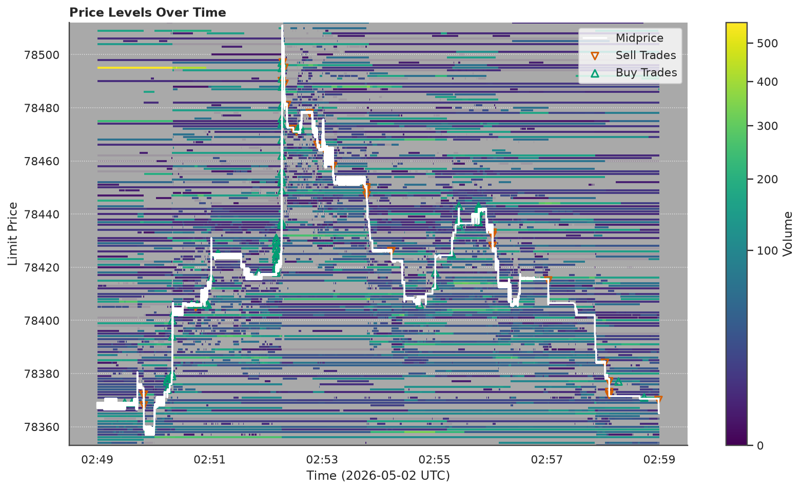

# ob-analytics

[](http://www.gnu.org/licenses/gpl-2.0.html)
[](https://github.com/mczielinski/ob-analytics/actions/workflows/ci.yml)
[](https://codecov.io/gh/mczielinski/ob-analytics)
[](https://www.python.org)

**Limit order book analytics and visualization for Python.**

Reconstruct trades from raw exchange events, classify order types, compute
depth metrics, and visualize market microstructure. It reads Bitstamp CSV,
[LOBSTER](https://lobsterdata.com/) message and orderbook files, Databento
market-by-order (DBN) files, and price-level (L2) depth CSV. It can also
capture live data from Bitstamp, from any venue that
[CCXT](https://github.com/ccxt/ccxt) supports, and from the venues of
[cryptofeed](https://github.com/bmoscon/cryptofeed).

> Ported from the R
> [obAnalytics](https://cran.r-project.org/package=obAnalytics) CRAN package.
> Now a standalone Python package with a pipeline API, pluggable sources,
> flow-toxicity and cost metrics, and Matplotlib and Plotly backends. Bokeh
> draws four of the plots.

<p align="center">
  
</p>

---

## Installation

```bash
pip install ob-analytics
```

With [uv](https://github.com/astral-sh/uv):

```bash
uv add ob-analytics
```

Optional extras:

```bash
pip install "ob-analytics[interactive]"   # Plotly figures
pip install "ob-analytics[bokeh]"         # Bokeh figures (four of the plots)
pip install "ob-analytics[databento]"     # read Databento DBN files
pip install "ob-analytics[live]"          # live Bitstamp capture (websockets)
pip install "ob-analytics[ccxt]"          # live L2 capture from CCXT venues
pip install "ob-analytics[cryptofeed]"    # live L2 or L3 capture through cryptofeed
```

Live capture (the `live`, `ccxt` and `cryptofeed` extras) is supported on
Linux and macOS only. CI does not test it on Windows, where it takes no lock
on the capture folder and Ctrl-C does not close the files cleanly. On
Windows, CI tests reading files, the analytics and the plots.

> **The documentation follows `main`.** The
> [docs site](https://mczielinski.github.io/ob-analytics/) is built from the
> `main` branch, so it can describe features that are not yet in the newest
> release on PyPI. To get everything the docs describe, install from source
> (below). [CHANGELOG.md](CHANGELOG.md) lists what changed since the last
> release.

### From source

Latest `main`, or a local clone for development:

```bash
pip install git+https://github.com/mczielinski/ob-analytics.git

# or
git clone https://github.com/mczielinski/ob-analytics.git
cd ob-analytics
pip install -e ".[interactive,live]"
```

**Requires** Python 3.11+. Core dependencies: NumPy, pandas, matplotlib,
seaborn, pydantic, pyarrow, loguru.

**Scale:** in-memory (pandas) — comfortable to ~5M events (about 4–5 GiB,
session-scale data). For larger inputs, `Pipeline.run_windows` runs one time window at a
time. See [Scale envelope](ARCHITECTURE.md#scale-envelope).

---

## Quickstart

### Bitstamp (bundled sample)

A 30-minute Bitstamp BTC/USD live capture (~314k events, ~280 trades) is
bundled with the package as paired `orders.csv.gz` + `trades.csv`. Point the
pipeline at the orders path; the companion trades file is auto-resolved:

```python
from ob_analytics import Pipeline, sample_csv_path

result = Pipeline().run(sample_csv_path())

result.events         # enriched events with order types and aggressiveness
result.trades         # trades from the live feed, with maker/taker attribution
result.depth          # price-level volume time series
result.depth_summary  # best bid/ask, BPS bins, spread
```

### LOBSTER

`trading_date` lives on `RunContext`, not on `LobsterSource`:

```python
from ob_analytics import Pipeline, LobsterSource, RunContext

result = Pipeline(
    source=LobsterSource(),
    ctx=RunContext(trading_date="2012-06-21"),
).run("/path/to/lobster_data")
```

### Flow-toxicity metrics

Flow-toxicity metrics are plain functions you call on `result.trades` after
the run. A size you pass is in the instrument's own units (here BTC), even
though the run stores sizes as whole lots:

```python
from ob_analytics import Pipeline, compute_vpin, compute_kyle_lambda, sample_csv_path

result = Pipeline().run(sample_csv_path())
vpin = compute_vpin(result.trades, bucket_volume=0.25)  # 0.25 BTC buckets
kyle = compute_kyle_lambda(result.trades)
```

The same metrics are registered by name, so `result.metric("vpin",
bucket_volume=0.25)` and `result.plot("vpin", bucket_volume=0.25)` give the
same buckets. Add your own metric to that registry, in your own package if you
like — see the [Extending guide](docs/extending.md).

### Live capture (Bitstamp)

With the `[live]` extra installed, capture a live order book straight to
`orders.csv` / `trades.csv` that the pipeline understands. A capture can run
for days: it reconnects, rolls to new files, continues after a restart, and
records every gap in `manifest.json`:

```bash
ob-analytics capture bitstamp --pair btcusd -o ./capture --minutes 30
```

`ob-analytics capture --list` shows live-capable sources: `bitstamp`, `ccxt`
(with `--venue`, for example `binance`, `coinbase`, `kalshi` or `polymarket`) and
`cryptofeed`. `ob-analytics sources` lists every source, file or live. Add new ones by
giving a `Source` the `LiveSource` capability and registering it with
`register_source`.

See the [full quickstart](https://mczielinski.github.io/ob-analytics/quickstart/)
for step-by-step usage, configuration, custom loaders, flow-toxicity metrics,
CLI commands, and demo scripts.

---

## Development

The project uses [uv](https://github.com/astral-sh/uv) for dependency
management. A `uv.lock` lockfile is committed for reproducible installs.

```bash
git clone https://github.com/mczielinski/ob-analytics.git
cd ob-analytics
uv sync --group dev --extra interactive
```

Pre-commit hooks (Ruff lint/format, `ty` type check) are configured in
`.pre-commit-config.yaml`:

```bash
uv run pre-commit install
```

### Testing & CI

```bash
uv run pytest tests/ -v
uv run ruff check ob_analytics/ tests/ scripts/
uv run ty check ob_analytics/ tests/ scripts/
```

CI runs automatically on push/PR via GitHub Actions — lint, type check,
pytest on Python 3.11 to 3.14, macOS and Windows, the lowest allowed
dependency versions, a core-only install of the built wheel, and Codecov
coverage upload. See [CONTRIBUTING.md](CONTRIBUTING.md#ci-checks) for the full
list.

See [ARCHITECTURE.md](ARCHITECTURE.md) (or the rendered
[Architecture page](https://mczielinski.github.io/ob-analytics/architecture/))
for design decisions, the module map, the class diagram, and the known
limitations.
See [CHANGELOG.md](CHANGELOG.md) for the release history.

---

## Documentation

Full docs at **<https://mczielinski.github.io/ob-analytics/>**:

- **[Getting started](https://mczielinski.github.io/ob-analytics/quickstart/)** — install, run the pipeline, first plot.
- **[Tutorial](https://mczielinski.github.io/ob-analytics/tutorial/)** — a guided tour from what a price *is* through L3 reconstruction, depth, and flow toxicity, every figure built up on toy data first.
- **[Example gallery](https://mczielinski.github.io/ob-analytics/gallery/)** — a figure for each main plot, each with its code.
- **[How-to guides](https://mczielinski.github.io/ob-analytics/howto/full-control/)** — task-focused recipes (your own data, LOBSTER, Databento, L2 feeds, live capture from each venue, custom loaders, CLI).
- **[API reference](https://mczielinski.github.io/ob-analytics/api/pipeline/)** and **[glossary](https://mczielinski.github.io/ob-analytics/glossary/)**.

The site is built with [Zensical](https://github.com/zensicalHQ/zensical);
the tutorial chapters and gallery are executed at build time, so their code
and figures never drift from the API. Build it locally with:

```bash
uv run python scripts/build_tutorial.py   # execute tutorial chapters
uv run python scripts/build_gallery.py    # render the example gallery
uv run zensical serve                     # local preview at http://localhost:8000
uv run zensical build                     # static site in site/
```

---

## Contributing

See [CONTRIBUTING.md](CONTRIBUTING.md) for development setup, code style,
and conventions for adding new formats. To report a security problem, see
[SECURITY.md](SECURITY.md); do not open a public issue for it.

## License

ob-analytics is licensed under the **GNU General Public License v2.0 or later
(GPL-2.0-or-later)** — see [LICENSE.md](LICENSE.md).

It is a Python port of the R
[obAnalytics](https://cran.r-project.org/package=obAnalytics) package
(© 2015–2016 Philip Stubbings), which is GPL-2.0-or-later; that copyleft is
inherited here.

## Citation

If you use ob-analytics in published work, please cite it — GitHub's **Cite this
repository** button reads [CITATION.cff](CITATION.cff), which also credits the
original R obAnalytics lineage.
